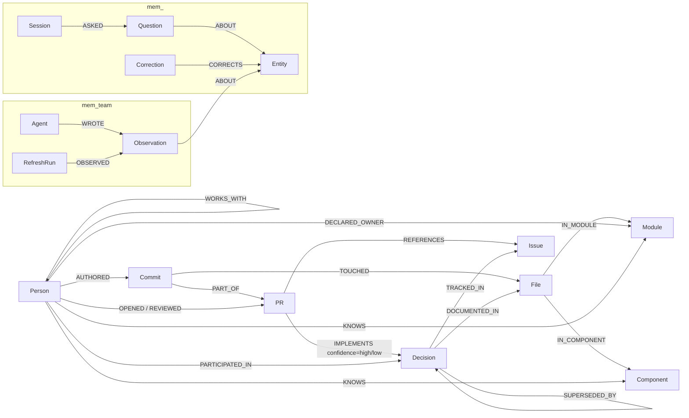

# Bus Factor

Bus Factor turns the public `delta-io/delta` GitHub repository into a FalkorDB graph of contributors, code, pull requests, RFC decisions, and ownership. It answers **“What does the project lose if this maintainer leaves?”** with graph evidence and inspectable Cypher, then drafts a sourced handover plan for the area at risk.

## What you can do

- Start on **What if someone leaves?** with the live headline (**25 of 69** active code areas in Delta Lake have a bus factor of 1), then search a ranked maintainer list. For each person you see the code areas that would have no other recent author, who reviewed that code, the decisions they worked on (explicit links kept apart from keyword guesses), and the graph evidence beside the results.
- On an exposed area, click **Draft handover**: a suggested successor with the evidence behind the choice, the PRs to read first, the decisions to preserve with their sources and quoted reasons, and questions for the person leaving. Save it to team memory, copy it as Markdown, or mark a candidate unavailable and watch the plan change.
- Open **Ask** and choose a named starter question or ask in your own words. With a server key, the agent answers from graph tools; **How I know** shows each tool's result rows, parameters and Cypher, the graph appears beside the answer, and graph-based follow-up chips keep the exploration going. Press **Tab** to accept a visible question completion.
- Explore without signing in. This browser gets an anonymous visitor id for memory; **Start over** clears that visitor's history and notes.
- Without an Anthropic key, **What if someone leaves?** and **Draft handover** still work, and named starter chips under **Ask** run their graph tools into readable tables; free-form chat says it needs an Anthropic API key on the server.

## Quick start: Docker

Install Docker with Compose, clone this public repository, and run:

```sh
docker compose up --build
```

The first `docker compose up --build` takes about five minutes to build the image. After that, the app waits for FalkorDB, loads the checked-in public snapshot into an empty `delta` graph, derives its relationships, and serves the UI at [http://127.0.0.1:8000](http://127.0.0.1:8000). Snapshot load, link, and derive took 6.2 seconds against a throwaway graph in local verification; actual bootstrap time depends on the machine. FalkorDB Browser is at [http://127.0.0.1:3000](http://127.0.0.1:3000). The named database volume preserves the graph across restarts. Without an Anthropic key, **What if someone leaves?** works and named starter chips under **Ask** show readable graph-tool tables; free-form chat explains that it needs a server key.

For chat, set host environment variables before starting Compose:

```sh
# POSIX shell
export ANTHROPIC_API_KEY=your-key
export ANTHROPIC_WORKSPACE_ID=your-workspace-id  # optional
export AGENT_MODEL=claude-sonnet-5-5              # optional
docker compose up --build
```

PowerShell:

```powershell
$env:ANTHROPIC_API_KEY = "your-key"
$env:ANTHROPIC_WORKSPACE_ID = "your-workspace-id" # optional
$env:AGENT_MODEL = "claude-sonnet-5-5"             # optional
docker compose up --build
```

The app container receives these variables at runtime; no key is copied into the image or snapshot.

## Local development

Install Python 3.11 or newer, `uv`, Docker, and Git. Then:

```sh
uv sync
docker compose up -d falkordb
uv run python -m busfactor.load all --from-snapshot
uv run python -m busfactor.link_decisions --from-snapshot
uv run python -m busfactor.derive
uv run python -m busfactor.api
```

The UI is at `http://127.0.0.1:8000`. These commands use only the included snapshot and do not need a GitHub token.

To rebuild from current public GitHub data, create a GitHub token with public repository read access and export `GITHUB_TOKEN`. Clone `https://github.com/delta-io/delta.git` to `data/delta` (Windows: `git clone -c core.longpaths=true ...`), then run:

```sh
uv run python -m busfactor.ingest.git_log
uv run python -m busfactor.ingest.rfcs
uv run python -m busfactor.ingest.codeowners
uv run python -m busfactor.ingest.github_api all
uv run python -m busfactor.load all
uv run python -m busfactor.link_decisions
uv run python -m busfactor.derive
```

GitHub GraphQL responses are cached under `data/raw/`. For an intentional API refresh, run `uv run python -m busfactor.ingest.github_api all --refresh`; local parsers can be rerun after pulling the Delta clone. Export a replacement checked-in snapshot with `uv run python -m busfactor.snapshot export` after reviewing its manifest and size.

## Graph model

`Component` sits below `Module` and splits large areas into packages. `Active` is a derived label for people with recent activity. `Commit.bulk` marks broad changes excluded from expertise and overlap scoring; `File.exists` records whether a path is present at the snapshot's repository HEAD. `IMPLEMENTS.confidence` is `high` for explicit issue or RFC-document evidence and `low` for a title keyword match.



The memory graphs are separate FalkorDB graphs. `Entity.key` (such as `component:kernel/kernel-api`) is joined to the company graph in Python because Cypher does not traverse across graphs. Each anonymous browser visitor has a `mem_v_<id>` graph for questions and corrections; watcher notes and sourced team claims live in the shared `mem_team` graph.

| Label | Stable key | Main properties |
|---|---|---|
| Person | `login` | name, bot, lastSeen; `Active` label when recent |
| Commit | `sha` | timestamp, subject, area, PR number, bulk flag |
| File | `path` | current-head `exists` flag |
| Module | `name` | first repository path segment |
| Component | `name` | package or deterministic path grouping |
| PR | `number` | title, state, body, merged and activity timestamps |
| Issue | `number` | title, state, created time, body (RFC tracking issues) |
| Decision | `slug` | title, proposed/decided status and dates |
| Session / Question | session `id`; Question has no stable key | prompt, answer, timestamp, tools |
| Entity | `key` | stable key joining memory to a graph entity |
| Correction | no stable key | user text, timestamp, source |
| Agent | `name` | watcher or user identity |
| Observation | `id` | shared note with `kind` (refresh note, visitor claim, availability note, saved handover), text, source, timestamp; availability notes add status and reason, saved handovers add person and candidate |
| RefreshRun | `id` | timestamp and new commit/PR counts |

Important relationships include `AUTHORED`, `TOUCHED`, `IN_MODULE`, `IN_COMPONENT`, `PART_OF`, `OPENED`, `REVIEWED`, `REFERENCES`, `TRACKED_IN`, `DOCUMENTED_IN`, `IMPLEMENTS {via, confidence}`, `SUPERSEDED_BY {source, rationale, rationaleSource}`, `DECLARED_OWNER`, `KNOWS {commits, lastTouched}`, `WORKS_WITH {sharedFiles}`, and `PARTICIPATED_IN {confidence}`. The memory relationships are `ASKED`, `ABOUT`, `CORRECTS`, `WROTE`, `OBSERVED`.

## What the numbers mean

- **Bus factor** (per code area, a Component): the fewest people whose commits cover at least half of the area's qualifying commits in the last 12 months. A commit qualifies when it is not a bulk change and touches a file that still exists at HEAD; a person counts in an area with 2+ such commits, and an area is reported with 5+. On 2026-10-17, 25 of 69 areas have a bus factor of 1 (18 of 48 over 6 months, 39 of 101 over 24 months).
- **Departure risk**: for each area where the leaving person made 2+ qualifying commits, `NO OTHER AUTHOR` (no other active person with 2+), `ONE OTHER AUTHOR`, or `COVERED`. Active reviewers of the area's recent PRs are listed beside the label and never change it, because writing code and reviewing it are different evidence. Each of the 19 areas with no other recent author held by the 15 most active people has 2 to 11 active reviewers, which is why handover candidates come from reviews as well as authorship.
- **Decision links**: explicit (the PR cites the RFC issue or touches the RFC document) or title match (a keyword in the PR title). 230 of 283 links are title matches, so every card and count shows the two separately and calls title matches keyword guesses.
- **What these are not**: they measure who wrote and reviewed public code, not who understands it, who is available, or what was discussed elsewhere.
- **A correction we made**: before 17 Oct the headline counted all two years of commits under a 12-month label (42 of 87). A pre-submission review caught the mismatch; every risk query now counts commits inside the window, and the leaving person must meet the same threshold as everyone else.

## Handover packets

**Draft handover** on an exposed area builds a packet from four queries (`18_handover_candidates`, `18b_handover_reading`, `18c_handover_decisions`, `06b_departure_files`) in under 0.1 s:

- **Suggested successor.** Candidates are recent authors of the area plus recent reviewers of PRs that touched it. Each kind of evidence is its own column: reviews of the leaving person's PRs here, shared files, own commits, reviews in the area, and shared decisions. They are ranked by a plain sort (reviews of this person's PRs first, because that reviewer has already seen these changes), not a weighted score. The "why" sentence is built only from those columns, and "Not touched yet" lists files only the leaving person edited.
- **Read these first:** up to three of the person's PRs, explicit decision links first, then the most files touched.
- **Decisions to preserve**, with links to the RFC and tracking issue, explicit and title-match counts, other active participants, and the reason quoted from the source when the graph has one (Managed Commits → Catalog-Managed Tables quotes tracking issue #4381 verbatim; it is parsed at load time, not written by a model).
- **Questions for the person leaving**, filled from templates, each tied to the row it came from, plus a caveat to confirm availability and readiness with the people involved.

Packets can be saved to the shared `mem_team` graph. An availability note, from the page (**Mark unavailable**) or from the chat agent (`mark_unavailable`), makes the next packet skip that person, label the note unverified, and say what changed since the saved packet. The chat agent drafts the same packet with `handover_plan`. Notes are written as the visitor, so **Start over** removes them.

## How answers are produced

The agent selects a small set of graph tools; each tool runs its own readable `.cypher` file against FalkorDB. The returned rows and paths form the **Answer evidence** graph beside the chat, and **How I know** shows readable tool labels, each tool's result rows as a table, its parameters, and its **Cypher query**. The **What if someone leaves?** view and handover packets need no LLM. Without a key, named starter questions under **Ask** call their graph tools directly and render readable tables; free-form chat is disabled with an explanation.

Names are checked against the graph before a tool runs. Every login, code area, decision slug or file path the model passes is looked up first (`17c`–`17i`). If a name is not in the graph, nothing else runs and the tool returns **Not in the graph** with suggestions from `find_entity` (`harper-jiang` → harperjiang, Hao Jiang). A person who is in the graph but not active in the last 12 months gets **Not active** with a last-seen date. When a known name's query returns no rows, the result says **No qualifying evidence** and names the query's threshold, so an empty result never reads as "nothing at risk". After the answer, a reply check looks for PR and issue numbers, logins, areas and decision titles in the text (`17j_reply_names`) and compares them with this turn's tool results. Any name not found there appears as a warning under the answer; the answer itself is never rewritten. **How I know** shows each call's outcome, row count, time and name checks, with the check queries' Cypher.

The departure graph keeps short paths only: the person, exposed areas, remaining authors, and Person → PR → Decision paths (explicit links solid, title matches dashed). Reviewers of areas with no other recent author appear as one dotted summary edge per reviewer ("reviewed 2 PRs here"); **Show full evidence** draws the PRs behind it. Decision cards link the RFC document, tracking issue and PRs on GitHub.

Where the time goes (2026-10-17): graph tools take 0.02–0.7 s; an answer takes 15–35 s, almost all of it model time across two or three model rounds. Follow-up questions under each answer are built from successful tools' result rows, not from the answer text, so every suggestion refers to something the graph returned.

The UI needs no sign-in: the browser keeps an anonymous visitor id for per-visitor memory, and **Start over** clears that visitor's history and starts a fresh id.

The product uses FalkorDB Cypher and full-text indexes for Decision and PR title search, `algo.betweenness` for collaboration bridges, `algo.WCC` for connected collaboration groups, `GRAPH.COPY` for an isolated departure what-if, and `GRAPH.RO_QUERY` for read-only tools. The graph is required for the simulator, the handover packet, paths, and graph answers.

## Query catalogue

Every query file is listed below with the question in its header. See [docs/QUERIES.md](docs/QUERIES.md) for parameters and query-shape explanations.

| Query file | What it answers |
|---|---|
| [`00_counts.cypher`](queries/00_counts.cypher) | Report total node and relationship counts for a graph. |
| [`00_indexes.cypher`](queries/00_indexes.cypher) | Prepare stable lookup keys for every node type loaded in this package. |
| [`01_load_commits.cypher`](queries/01_load_commits.cypher) | Load people, commits, touched files, modules, and components from local git history. |
| [`01b_link_part_of.cypher`](queries/01b_link_part_of.cypher) | Link loaded commits to any PR nodes whose numbers match Commit.pr. |
| [`01c_load_prs.cypher`](queries/01c_load_prs.cypher) | Load GitHub pull requests and their opener/reviewer people. |
| [`01d_load_issues.cypher`](queries/01d_load_issues.cypher) | Load the RFC tracking issues and people who opened or commented on them. |
| [`01e_link_references.cypher`](queries/01e_link_references.cypher) | Connect PRs to referenced RFC issues that are already represented in the graph. |
| [`01f_cleanup_components.cypher`](queries/01f_cleanup_components.cypher) | Remove Component nodes left without any File membership after a path-rule update. |
| [`01g_component_activity.cypher`](queries/01g_component_activity.cypher) | Rank Components by recent authored file touches for the path-mapping report. |
| [`01h_component_count.cypher`](queries/01h_component_count.cypher) | Count Component nodes after path mapping. |
| [`02_load_decisions.cypher`](queries/02_load_decisions.cypher) | Load RFC decisions, their tracking issues, and RFC document files. |
| [`02b_superseded_by.cypher`](queries/02b_superseded_by.cypher) | Record that one decision was superseded by another, with the evidence and the stated reason. |
| [`02c_load_codeowners.cypher`](queries/02c_load_codeowners.cypher) | Load declared CODEOWNERS handles and the modules covered by each rule. |
| [`03_derive_knows.cypher`](queries/03_derive_knows.cypher) | Derive each non-bot person's commit expertise and most recent touch per module. |
| [`03b_derive_last_seen.cypher`](queries/03b_derive_last_seen.cypher) | Refresh each person's last commit/activity time and the Active label for the requested window; reviews count because maintainers can contribute without committing. |
| [`03c_derive_knows_component.cypher`](queries/03c_derive_knows_component.cypher) | Derive each non-bot person's expertise and latest touch per Component. |
| [`03d_mark_bulk_commits.cypher`](queries/03d_mark_bulk_commits.cypher) | Mark commits that touched more than the configured number of files as bulk changes. |
| [`03g_sanity_top_modules.cypher`](queries/03g_sanity_top_modules.cypher) | List Modules with the most derived KNOWS edges for derive sanity reporting. |
| [`03h_sanity_top_components.cypher`](queries/03h_sanity_top_components.cypher) | List Components with the most derived KNOWS edges for derive sanity reporting. |
| [`03i_sanity_active_count.cypher`](queries/03i_sanity_active_count.cypher) | Count people marked Active after the derive pass. |
| [`03j_sanity_works_count.cypher`](queries/03j_sanity_works_count.cypher) | Count derived WORKS_WITH relationships. |
| [`03k_sanity_top_pairs.cypher`](queries/03k_sanity_top_pairs.cypher) | List the five strongest WORKS_WITH pairs. |
| [`03l_sanity_participation.cypher`](queries/03l_sanity_participation.cypher) | Count participating people for each decision. |
| [`03m_sanity_relationship_count.cypher`](queries/03m_sanity_relationship_count.cypher) | Count all graph relationships after a derive query. |
| [`04_derive_works_with.cypher`](queries/04_derive_works_with.cypher) | Derive recent collaboration between non-bot people from files both edited. |
| [`04b_derive_participated_pr.cypher`](queries/04b_derive_participated_pr.cypher) | Mark non-bot people who opened or reviewed a PR that implements a decision. |
| [`04c_derive_participated_issue.cypher`](queries/04c_derive_participated_issue.cypher) | Mark non-bot people who opened or commented on an RFC issue tracked by a decision. |
| [`04d_derive_implements_issue_ref.cypher`](queries/04d_derive_implements_issue_ref.cypher) | Link PRs to decisions whose tracked RFC issue the PR body references. |
| [`04e_derive_implements_rfc_doc.cypher`](queries/04e_derive_implements_rfc_doc.cypher) | Link PRs that changed an RFC markdown document to that RFC's decision. |
| [`04f_load_implements_keyword.cypher`](queries/04f_load_implements_keyword.cypher) | Load low-confidence title keyword links from the curated Python matcher. |
| [`04g_link_pr_titles.cypher`](queries/04g_link_pr_titles.cypher) | Load PR number and title pairs for the curated decision keyword matcher. |
| [`04h_implements_counts_by_via.cypher`](queries/04h_implements_counts_by_via.cypher) | Count IMPLEMENTS edges by evidence source. |
| [`04i_implements_counts_by_decision.cypher`](queries/04i_implements_counts_by_decision.cypher) | Count IMPLEMENTS edges for every Decision, including decisions without links. |
| [`04j_recent_implements.cypher`](queries/04j_recent_implements.cypher) | Return the three most recent PR implementations for one decision. |
| [`04k_delete_stale_keyword_links.cypher`](queries/04k_delete_stale_keyword_links.cypher) | Remove stale title-keyword-only IMPLEMENTS links before rebuilding curated matches. |
| [`05_bus_factor.cypher`](queries/05_bus_factor.cypher) | Calculate how many people cover half of qualifying in-window commits in each Module. |
| [`05_bus_factor_graph.cypher`](queries/05_bus_factor_graph.cypher) | Show exactly the authors counted toward each reported Module bus factor. |
| [`05b_bus_factor_component.cypher`](queries/05b_bus_factor_component.cypher) | Calculate how many people cover half of qualifying in-window commits in each Component. |
| [`05b_bus_factor_component_graph.cypher`](queries/05b_bus_factor_component_graph.cypher) | Show exactly the authors counted toward each reported Component bus factor. |
| [`06_departure_impact.cypher`](queries/06_departure_impact.cypher) | Report areas with 2+ (or $minCommits) recent commits by the leaving person, remaining authors, and separate review evidence. |
| [`06_departure_impact_graph.cypher`](queries/06_departure_impact_graph.cypher) | Show only the leaving/remaining authors and listed reviewers from the departure table. |
| [`06b_departure_files.cypher`](queries/06b_departure_files.cypher) | Group files touched by a departing person that no other active, non-bot person touched recently. |
| [`06b_departure_files_graph.cypher`](queries/06b_departure_files_graph.cypher) | Show the exact orphaned files reported for a departing person, with their source commits and Components. |
| [`07_orphaned_decisions.cypher`](queries/07_orphaned_decisions.cypher) | Find decisions for which the departing person is the only currently active participant at the requested evidence confidence. |
| [`07_orphaned_decisions_graph.cypher`](queries/07_orphaned_decisions_graph.cypher) | Show the departing person's participation in each orphaned Decision and every qualifying person to ask. |
| [`07b_decision_share.cypher`](queries/07b_decision_share.cypher) | Report a person's share of implementing PRs, split into explicit evidence and title-only keyword guesses. |
| [`07b_decision_share_graph.cypher`](queries/07b_decision_share_graph.cypher) | Show the PR-opening paths behind decision-share ownership and the active co-openers to ask. |
| [`08_successor.cypher`](queries/08_successor.cypher) | Rank active non-bot successors for a departing person's Component by shared recent files, then component commits. |
| [`08_successor_graph.cypher`](queries/08_successor_graph.cypher) | Show both the departing person and each ranked successor on only their shared recent files. |
| [`09_bridges.cypher`](queries/09_bridges.cypher) | Rank active non-bot people by betweenness in the recent WORKS_WITH network. |
| [`09_bridges_graph.cypher`](queries/09_bridges_graph.cypher) | Show top bridge people, their WORKS_WITH neighbors, and the relationships among those nodes. |
| [`09b_groups.cypher`](queries/09b_groups.cypher) | Count active collaboration groups, the largest group, and groups with more than one person. |
| [`09b_groups_graph.cypher`](queries/09b_groups_graph.cypher) | Show the largest active collaboration group and its internal WORKS_WITH edges. |
| [`09c_whatif_membership.cypher`](queries/09c_whatif_membership.cypher) | Map each active person with at least one active WORKS_WITH edge to their WCC component. |
| [`09d_whatif_remove_active.cypher`](queries/09d_whatif_remove_active.cypher) | Remove one person's Active label only in the temporary what-if graph. |
| [`09e_whatif_graph.cypher`](queries/09e_whatif_graph.cypher) | Show the departing person, their direct collaborators, and people cut off from the largest surviving group. |
| [`09f_whatif_collaborators.cypher`](queries/09f_whatif_collaborators.cypher) | List a person's active, non-bot direct WORKS_WITH collaborators before departure. |
| [`10_decision_trace.cypher`](queries/10_decision_trace.cypher) | Show recent file-to-decision evidence paths, including how each PR was linked to the decision. |
| [`10b_why_not.cypher`](queries/10b_why_not.cypher) | Explain which accepted decision replaced a rejected decision, why (when the sources say), and who can explain it. |
| [`10b_why_not_graph.cypher`](queries/10b_why_not_graph.cypher) | Show a rejected Decision's replacement, tracking Issue, and people who participated in the replacement. |
| [`11_drift.cypher`](queries/11_drift.cypher) | Count code changes since accepted decisions were made and identify editors who did not participate. |
| [`11_drift_graph.cypher`](queries/11_drift_graph.cypher) | Show accepted-decision implementation paths and later edits on the files behind them. |
| [`12_declared_vs_actual.cypher`](queries/12_declared_vs_actual.cypher) | Compare module-level CODEOWNERS declarations with the top three recent, non-bot commit experts. |
| [`12_declared_vs_actual_graph.cypher`](queries/12_declared_vs_actual_graph.cypher) | Show declared owners and the top three observed experts for each reported Module. |
| [`13_find_entity.cypher`](queries/13_find_entity.cypher) | Resolve free text to people, modules, Components, decisions, or files using graph indexes and string matching. |
| [`13_find_entity_graph.cypher`](queries/13_find_entity_graph.cypher) | Return only the graph entities matched by find_entity, with no neighboring edges. |
| [`14_mem_record_episode.cypher`](queries/14_mem_record_episode.cypher) | Save one user question and answer as an episode linked to touched graph entities. |
| [`14b_mem_store_correction.cypher`](queries/14b_mem_store_correction.cypher) | Store a user correction as memory attached to a stable graph entity key. |
| [`14c_mem_recall.cypher`](queries/14c_mem_recall.cypher) | Recall recent questions and corrections for given entities, or the user's last five episodes. |
| [`14d_changed_since.cypher`](queries/14d_changed_since.cypher) | Count and list commits and PRs connected to one supported graph entity since a timestamp. |
| [`15_refresh_watermarks.cypher`](queries/15_refresh_watermarks.cypher) | Return the newest loaded Commit timestamp and PR update timestamp. |
| [`15a_refresh_head_files.cypher`](queries/15a_refresh_head_files.cypher) | Recompute whether each known File exists at the current Git HEAD. |
| [`15b_refresh_component_risk.cypher`](queries/15b_refresh_component_risk.cypher) | Count each Component's qualifying recent authors so refresh can report coverage changes (no departure simulated). |
| [`16_team_write_observation.cypher`](queries/16_team_write_observation.cypher) | Write one shared observation about a stable entity key in mem_team. |
| [`16b_team_recall.cypher`](queries/16b_team_recall.cypher) | Retrieve shared observations for selected entities and the newest five overall. |
| [`16c_team_record_refresh.cypher`](queries/16c_team_record_refresh.cypher) | Create an idempotent shared RefreshRun and connect its observations. |
| [`16d_team_list.cypher`](queries/16d_team_list.cypher) | List recent shared Observations and RefreshRuns for the team-memory API. |
| [`16e_team_write_availability.cypher`](queries/16e_team_write_availability.cypher) | Record in shared team memory that a person is or is not available to take over work. |
| [`16f_team_availability.cypher`](queries/16f_team_availability.cypher) | The latest availability note for every person who has one, so handover candidates can be skipped with their reason. |
| [`16g_team_write_handover.cypher`](queries/16g_team_write_handover.cypher) | Save a drafted handover packet to shared team memory so other visitors and later sessions see it. |
| [`16h_team_last_handover.cypher`](queries/16h_team_last_handover.cypher) | The most recently saved handover packet for one leaving person and one component. |
| [`17_people_search.cypher`](queries/17_people_search.cypher) | Search active non-bot maintainers by recent non-bulk authored commit activity. |
| [`17b_team_delete_visitor_claims.cypher`](queries/17b_team_delete_visitor_claims.cypher) | Delete shared team-memory observations written by one anonymous visitor and return the number removed. |
| [`17c_active_person.cypher`](queries/17c_active_person.cypher) | Whether a login is an active, non-bot person, and their display name. |
| [`17d_component_exists.cypher`](queries/17d_component_exists.cypher) | Whether a code area (Component) with this exact name exists. |
| [`17e_person_status.cypher`](queries/17e_person_status.cypher) | Whether a login belongs to any Person, including inactive people and bots. |
| [`17f_component_prefix.cypher`](queries/17f_component_prefix.cypher) | How many Components have names starting with the requested prefix. |
| [`17g_decision_exists.cypher`](queries/17g_decision_exists.cypher) | Whether an exact decision slug exists, regardless of outcome or supersession. |
| [`17h_file_exists.cypher`](queries/17h_file_exists.cypher) | Whether an exact file path exists in the graph and whether it exists at HEAD. |
| [`17i_module_exists.cypher`](queries/17i_module_exists.cypher) | Whether a correction refers to an existing Module. |
| [`17j_reply_names.cypher`](queries/17j_reply_names.cypher) | Which graph names the final reply should check against this turn's evidence. |
| [`18_handover_candidates.cypher`](queries/18_handover_candidates.cypher) | Who could take over one code area from a leaving person, with each kind of evidence in its own column. |
| [`18_handover_graph.cypher`](queries/18_handover_graph.cypher) | Show the paths behind one handover packet: the leaving person's reading PRs, their decision links, candidate reviews of those PRs, and authorship of the area. |
| [`18b_handover_reading.cypher`](queries/18b_handover_reading.cypher) | Which of the leaving person's recent PRs in one code area a successor should read first. |
| [`18c_handover_decisions.cypher`](queries/18c_handover_decisions.cypher) | Which RFC decisions a successor must preserve in one code area, with their sources and who else took part. |
| [`18e_handover_activity_since.cypher`](queries/18e_handover_activity_since.cypher) | How much work landed in one code area after a saved handover packet, to explain why a new packet differs. |

## Tracks entered

- **03 Company Brain:** one graph connects people, code modules and components, PRs, reviews, RFC decisions, issues, and declared ownership. It answers who wrote and who reviewed each area, traces decisions back to their sources (with the stated reason where the source gives one), and gets work done: a sourced handover plan for an exposed area that can be pasted into an issue.
- **02 Agent Memory and Coordination:** each visitor gets a `mem_v_<id>` graph for questions and corrections; the shared `mem_team` graph holds refresh observations from the watcher, visitor claims, availability notes and saved handover plans. Different writers share that state: an availability note left by the chat agent or on the page changes the next handover packet, which says what changed since the saved one. Per-visitor recall also reports what changed in the company graph since earlier questions.

## Data quality choices

- Broad commits remain available for history and decision traces, but are marked `bulk` and excluded from expertise and collaboration scoring.
- Deleted files remain historical graph nodes with `exists=false`; only paths in the HEAD list count as current code.
- Bot identities are retained for provenance and excluded from human expertise rankings.
- Git email identities use GitHub's public commit-author mapping when present, GitHub noreply identity when explicit, and `email:<address>` otherwise. The system does not guess aliases.
- Explicit issue and RFC-document links are high confidence. PR title keyword links use word-boundary matching and remain low confidence; they are counted and labelled separately everywhere, and callers can require high-confidence evidence.
- Risk counts only commits inside the 12-month window, from AUTHORED/TOUCHED directly; `KNOWS.commits` keeps the all-history count for other uses.

## Agent model

The default is **Claude Sonnet 5.5 at medium effort**. The five-question evaluation in [docs/eval/](docs/eval/) recorded 69 seconds and $0.37 total, compared with 112 seconds and $1.17 for Opus 5.5 at medium; low effort missed one ambiguous question. The graph results and answer quality remain limited by the underlying public repository evidence.

## Demo and deployment

The app runs locally through Docker Compose; there is no hosted deployment. See [docs/DEMO.md](docs/DEMO.md) for the three-minute walkthrough and [docs/BLOG.md](docs/BLOG.md) for the side-prize draft. The developer will record the demo video.

## Built with AI assistance

This is a solo entry. The developer set the direction and made the decisions; AI tools wrote the code. From the session records, the developer:

- planned the project with Claude (chat) on 14 Oct, before coding began, and recorded the decisions in [docs/PLAN.md](docs/PLAN.md): the departure question, `delta-io/delta` as the data source, and the graph model;
- chose the way of working (Codex implements each work package from a written brief; Claude Code reviews it against the live graph) and set up Docker, the GitHub token and the public repository;
- chose the Claude API for the agent and Claude Sonnet 5.5 over Opus 5.5 on cost, because the graph tools do the reasoning; the evaluation in [docs/eval/](docs/eval/) then confirmed the choice;
- tested the app as a newcomer would and wrote the feedback behind the WP11 redesign: no GitHub-login box on the first screen, a searchable list of maintainers ranked by activity instead of a free-text field, suggested questions with Tab completion, and three or four follow-up questions after each answer; and asked for that plan to be reviewed by Codex on GPT-6-Astra;
- re-tested the redesign and reported, with screenshots, the problems fixed in WP11d: starter questions below the fold, a starter chip that returned no answer, layout gaps, and an unclear visitor identity;
- commissioned the pre-submission review (Codex on GPT-6-Astra), weighed it with Claude Code, and chose what to act on (the must and should items, WP13a, WP13b and WP14, not the stretch items);
- asked for a comparison with the organisers' guidance post on 17 Oct, which led to the name checks in WP15 and the deployment plan in WP16, and required a check for private references before every push.

Claude Code (Claude Opus 5.5) reviewed and orchestrated the work; OpenAI Codex implemented work packages WP1–WP12, most of WP13a and most of WP15 (name checks; it stopped at its usage limit before its report, and Claude Code reviewed the work and made the remaining fixes). The plan and graph model in [docs/PLAN.md](docs/PLAN.md) were drafted with Claude (chat) on 14 Oct, before coding began; that was design work only. Codex on GPT-6-Astra reviewed the UX revamp plan (WP11) and, on 17 Oct, the whole project before submission; Claude Code checked that review against the code and the live graph, confirmed its findings (the headline window mismatch, the missing threshold for the leaving person, ignored reviews, mostly keyword decision links, hidden evidence rows) and wrote the WP13a, WP13b and WP14 briefs. When Codex hit its usage limit during WP13a, the developer asked Claude Code to finish the WP13a review fixes and to implement WP13b (inspectable evidence and quoted decision reasons) and WP14 (handover packets) directly. Every task brief, report, and review round is recorded in [docs/tasks/](docs/tasks/). The reviewer ran live integration tests, browser walkthroughs, and the model evaluation in [docs/eval/](docs/eval/). The running agent calls Claude Sonnet 5.5.

## License

MIT, see LICENSE.
