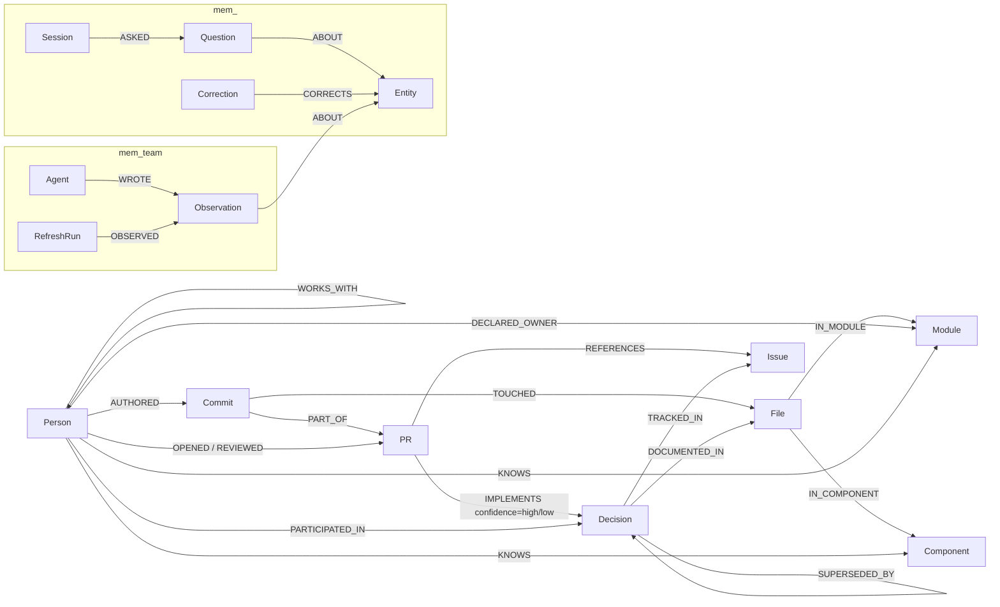

# Bus Factor

Bus Factor turns the public `delta-io/delta` GitHub repository into a FalkorDB graph of contributors, code, pull requests, RFC decisions, and ownership. It answers **“What does the project lose if this maintainer leaves?”** with graph evidence and inspectable Cypher.

## What you can do

- Start on **What if someone leaves?** with the live bus-factor headline, then search a ranked maintainer list and inspect exposed code areas, decisions, successors, and their graph evidence.
- Open **Ask** and choose a named starter question or ask in your own words. With a server key, the agent answers from graph tools; **How I know** shows the tool rows and Cypher, the graph appears beside the answer, and graph-based follow-up chips keep the exploration going. Press **Tab** to accept a visible question completion.
- Explore without signing in. This browser gets an anonymous visitor id for memory; **Start over** clears that visitor's history.
- Without an Anthropic key, **What if someone leaves?** still works and named starter chips under **Ask** run their graph tools into readable tables; free-form chat says it needs an Anthropic API key on the server.

## Quick start: Docker

Install Docker with Compose, clone this public repository, and run:

```sh
docker compose up --build
```

The first `docker compose up --build` takes about five minutes to build the image. After that, the app waits for FalkorDB, loads the checked-in public snapshot into an empty `delta` graph, derives its relationships, and serves the UI at [http://127.0.0.1:8000](http://127.0.0.1:8000). Snapshot load, link, and derive took 6.2 seconds against a throwaway graph in local verification; actual bootstrap time depends on the machine. FalkorDB Browser is at [http://127.0.0.1:3000](http://127.0.0.1:3000). The named database volume preserves the graph across restarts. Without an Anthropic key, **What if someone leaves?** works and named starter chips under **Ask** show readable graph-tool tables; free-form chat explains that it needs a server key.

For chat, set host environment variables before starting Compose:

```sh
# POSIX shell
export ANTHROPIC_API_KEY=your-key
export ANTHROPIC_WORKSPACE_ID=your-workspace-id  # optional
export AGENT_MODEL=claude-sonnet-5-5              # optional
docker compose up --build
```

PowerShell:

```powershell
$env:ANTHROPIC_API_KEY = "your-key"
$env:ANTHROPIC_WORKSPACE_ID = "your-workspace-id" # optional
$env:AGENT_MODEL = "claude-sonnet-5-5"             # optional
docker compose up --build
```

The app container receives these variables at runtime; no key is copied into the image or snapshot.

## Local development

Install Python 3.11 or newer, `uv`, Docker, and Git. Then:

```sh
uv sync
docker compose up -d falkordb
uv run python -m busfactor.load all --from-snapshot
uv run python -m busfactor.link_decisions --from-snapshot
uv run python -m busfactor.derive
uv run python -m busfactor.api
```

The UI is at `http://127.0.0.1:8000`. These commands use only the included snapshot and do not need a GitHub token.

To rebuild from current public GitHub data, create a GitHub token with public repository read access and export `GITHUB_TOKEN`. Clone `https://github.com/delta-io/delta.git` to `data/delta` (Windows: `git clone -c core.longpaths=true ...`), then run:

```sh
uv run python -m busfactor.ingest.git_log
uv run python -m busfactor.ingest.rfcs
uv run python -m busfactor.ingest.codeowners
uv run python -m busfactor.ingest.github_api all
uv run python -m busfactor.load all
uv run python -m busfactor.link_decisions
uv run python -m busfactor.derive
```

GitHub GraphQL responses are cached under `data/raw/`. For an intentional API refresh, run `uv run python -m busfactor.ingest.github_api all --refresh`; local parsers can be rerun after pulling the Delta clone. Export a replacement checked-in snapshot with `uv run python -m busfactor.snapshot export` after reviewing its manifest and size.

## Graph model

`Component` sits below `Module` and splits large areas into packages. `Active` is a derived label for people with recent activity. `Commit.bulk` marks broad changes excluded from expertise and overlap scoring; `File.exists` records whether a path is present at the snapshot's repository HEAD. `IMPLEMENTS.confidence` is `high` for explicit issue or RFC-document evidence and `low` for a title keyword match.



The memory graphs are separate FalkorDB graphs. `Entity.key` (such as `component:kernel/kernel-api`) is joined to the company graph in Python because Cypher does not traverse across graphs. Each anonymous browser visitor has a `mem_v_<id>` graph for questions and corrections; watcher notes and sourced team claims live in the shared `mem_team` graph.

| Label | Stable key | Main properties |
|---|---|---|
| Person | `login` | name, bot, lastSeen; `Active` label when recent |
| Commit | `sha` | timestamp, subject, area, PR number, bulk flag |
| File | `path` | current-head `exists` flag |
| Module | `name` | first repository path segment |
| Component | `name` | package or deterministic path grouping |
| PR | `number` | title, state, body, merged and activity timestamps |
| Issue | `number` | title, state, created time |
| Decision | `slug` | title, proposed/decided status and dates |
| Session / Question | session `id`; Question has no stable key | prompt, answer, timestamp, tools |
| Entity | `key` | stable key joining memory to a graph entity |
| Correction | no stable key | user text, timestamp, source |
| Agent | `name` | watcher or user identity |
| Observation | `id` | deterministic shared note, type, text, source, timestamp |
| RefreshRun | `id` | timestamp and new commit/PR counts |

Important relationships include `AUTHORED`, `TOUCHED`, `IN_MODULE`, `IN_COMPONENT`, `PART_OF`, `OPENED`, `REVIEWED`, `REFERENCES`, `TRACKED_IN`, `DOCUMENTED_IN`, `IMPLEMENTS {via, confidence}`, `SUPERSEDED_BY`, `DECLARED_OWNER`, `KNOWS {commits, lastTouched}`, `WORKS_WITH {sharedFiles}`, and `PARTICIPATED_IN {confidence}`. The memory relationships are `ASKED`, `ABOUT`, `CORRECTS`, `WROTE`, `OBSERVED`.

## How answers are produced

The agent selects a small set of graph tools; each tool runs its own readable `.cypher` file against FalkorDB. The returned rows and paths form the **Answer evidence** graph beside the chat, and **How I know** shows readable tool labels, result rows, parameters, and each tool's **Cypher query**. The **What if someone leaves?** view needs no LLM. Without a key, named starter questions under **Ask** call their graph tools directly and render readable tables; free-form chat is disabled with an explanation.

Where the time goes (server log, 2026-10-17): graph tools take about 0.3 s, while an answer takes 10–20 s and most of that is model time. Follow-up questions under each answer are built from successful tools' result rows, not from the answer text, so every suggestion refers to something the graph returned.

The UI needs no sign-in: the browser keeps an anonymous visitor id for per-visitor memory, and **Start over** clears that visitor's history and starts a fresh id.

The product uses FalkorDB Cypher and full-text indexes for Decision and PR title search, `algo.betweenness` for collaboration bridges, `algo.WCC` for connected collaboration groups, `GRAPH.COPY` for an isolated departure what-if, and `GRAPH.RO_QUERY` for read-only tools. The graph is required for the simulator, paths, and graph answers.

## Query catalogue

Every query file is listed below. See [docs/QUERIES.md](docs/QUERIES.md) for parameter details and query-shape explanations.

| Query file | What it answers |
|---|---|
| [`00_counts.cypher`](queries/00_counts.cypher) | See the query header and docs/QUERIES.md. |
| [`00_indexes.cypher`](queries/00_indexes.cypher) | See the query header and docs/QUERIES.md. |
| [`01_load_commits.cypher`](queries/01_load_commits.cypher) | See the query header and docs/QUERIES.md. |
| [`01b_link_part_of.cypher`](queries/01b_link_part_of.cypher) | See the query header and docs/QUERIES.md. |
| [`01c_load_prs.cypher`](queries/01c_load_prs.cypher) | See the query header and docs/QUERIES.md. |
| [`01d_load_issues.cypher`](queries/01d_load_issues.cypher) | See the query header and docs/QUERIES.md. |
| [`01e_link_references.cypher`](queries/01e_link_references.cypher) | See the query header and docs/QUERIES.md. |
| [`01f_cleanup_components.cypher`](queries/01f_cleanup_components.cypher) | See the query header and docs/QUERIES.md. |
| [`01g_component_activity.cypher`](queries/01g_component_activity.cypher) | See the query header and docs/QUERIES.md. |
| [`01h_component_count.cypher`](queries/01h_component_count.cypher) | See the query header and docs/QUERIES.md. |
| [`02_load_decisions.cypher`](queries/02_load_decisions.cypher) | See the query header and docs/QUERIES.md. |
| [`02b_superseded_by.cypher`](queries/02b_superseded_by.cypher) | See the query header and docs/QUERIES.md. |
| [`02c_load_codeowners.cypher`](queries/02c_load_codeowners.cypher) | See the query header and docs/QUERIES.md. |
| [`03_derive_knows.cypher`](queries/03_derive_knows.cypher) | See the query header and docs/QUERIES.md. |
| [`03b_derive_last_seen.cypher`](queries/03b_derive_last_seen.cypher) | See the query header and docs/QUERIES.md. |
| [`03c_derive_knows_component.cypher`](queries/03c_derive_knows_component.cypher) | See the query header and docs/QUERIES.md. |
| [`03d_mark_bulk_commits.cypher`](queries/03d_mark_bulk_commits.cypher) | See the query header and docs/QUERIES.md. |
| [`03g_sanity_top_modules.cypher`](queries/03g_sanity_top_modules.cypher) | See the query header and docs/QUERIES.md. |
| [`03h_sanity_top_components.cypher`](queries/03h_sanity_top_components.cypher) | See the query header and docs/QUERIES.md. |
| [`03i_sanity_active_count.cypher`](queries/03i_sanity_active_count.cypher) | See the query header and docs/QUERIES.md. |
| [`03j_sanity_works_count.cypher`](queries/03j_sanity_works_count.cypher) | See the query header and docs/QUERIES.md. |
| [`03k_sanity_top_pairs.cypher`](queries/03k_sanity_top_pairs.cypher) | See the query header and docs/QUERIES.md. |
| [`03l_sanity_participation.cypher`](queries/03l_sanity_participation.cypher) | See the query header and docs/QUERIES.md. |
| [`03m_sanity_relationship_count.cypher`](queries/03m_sanity_relationship_count.cypher) | See the query header and docs/QUERIES.md. |
| [`04_derive_works_with.cypher`](queries/04_derive_works_with.cypher) | See the query header and docs/QUERIES.md. |
| [`04b_derive_participated_pr.cypher`](queries/04b_derive_participated_pr.cypher) | See the query header and docs/QUERIES.md. |
| [`04c_derive_participated_issue.cypher`](queries/04c_derive_participated_issue.cypher) | See the query header and docs/QUERIES.md. |
| [`04d_derive_implements_issue_ref.cypher`](queries/04d_derive_implements_issue_ref.cypher) | See the query header and docs/QUERIES.md. |
| [`04e_derive_implements_rfc_doc.cypher`](queries/04e_derive_implements_rfc_doc.cypher) | See the query header and docs/QUERIES.md. |
| [`04f_load_implements_keyword.cypher`](queries/04f_load_implements_keyword.cypher) | See the query header and docs/QUERIES.md. |
| [`04g_link_pr_titles.cypher`](queries/04g_link_pr_titles.cypher) | See the query header and docs/QUERIES.md. |
| [`04h_implements_counts_by_via.cypher`](queries/04h_implements_counts_by_via.cypher) | See the query header and docs/QUERIES.md. |
| [`04i_implements_counts_by_decision.cypher`](queries/04i_implements_counts_by_decision.cypher) | See the query header and docs/QUERIES.md. |
| [`04j_recent_implements.cypher`](queries/04j_recent_implements.cypher) | See the query header and docs/QUERIES.md. |
| [`04k_delete_stale_keyword_links.cypher`](queries/04k_delete_stale_keyword_links.cypher) | See the query header and docs/QUERIES.md. |
| [`05_bus_factor.cypher`](queries/05_bus_factor.cypher) | See the query header and docs/QUERIES.md. |
| [`05_bus_factor_graph.cypher`](queries/05_bus_factor_graph.cypher) | See the query header and docs/QUERIES.md. |
| [`05b_bus_factor_component.cypher`](queries/05b_bus_factor_component.cypher) | See the query header and docs/QUERIES.md. |
| [`05b_bus_factor_component_graph.cypher`](queries/05b_bus_factor_component_graph.cypher) | See the query header and docs/QUERIES.md. |
| [`06_departure_impact.cypher`](queries/06_departure_impact.cypher) | See the query header and docs/QUERIES.md. |
| [`06_departure_impact_graph.cypher`](queries/06_departure_impact_graph.cypher) | See the query header and docs/QUERIES.md. |
| [`06b_departure_files.cypher`](queries/06b_departure_files.cypher) | See the query header and docs/QUERIES.md. |
| [`06b_departure_files_graph.cypher`](queries/06b_departure_files_graph.cypher) | See the query header and docs/QUERIES.md. |
| [`07_orphaned_decisions.cypher`](queries/07_orphaned_decisions.cypher) | See the query header and docs/QUERIES.md. |
| [`07_orphaned_decisions_graph.cypher`](queries/07_orphaned_decisions_graph.cypher) | See the query header and docs/QUERIES.md. |
| [`07b_decision_share.cypher`](queries/07b_decision_share.cypher) | See the query header and docs/QUERIES.md. |
| [`07b_decision_share_graph.cypher`](queries/07b_decision_share_graph.cypher) | See the query header and docs/QUERIES.md. |
| [`08_successor.cypher`](queries/08_successor.cypher) | See the query header and docs/QUERIES.md. |
| [`08_successor_graph.cypher`](queries/08_successor_graph.cypher) | See the query header and docs/QUERIES.md. |
| [`09_bridges.cypher`](queries/09_bridges.cypher) | See the query header and docs/QUERIES.md. |
| [`09_bridges_graph.cypher`](queries/09_bridges_graph.cypher) | See the query header and docs/QUERIES.md. |
| [`09b_groups.cypher`](queries/09b_groups.cypher) | See the query header and docs/QUERIES.md. |
| [`09b_groups_graph.cypher`](queries/09b_groups_graph.cypher) | See the query header and docs/QUERIES.md. |
| [`09c_whatif_membership.cypher`](queries/09c_whatif_membership.cypher) | See the query header and docs/QUERIES.md. |
| [`09d_whatif_remove_active.cypher`](queries/09d_whatif_remove_active.cypher) | See the query header and docs/QUERIES.md. |
| [`09e_whatif_graph.cypher`](queries/09e_whatif_graph.cypher) | See the query header and docs/QUERIES.md. |
| [`09f_whatif_collaborators.cypher`](queries/09f_whatif_collaborators.cypher) | See the query header and docs/QUERIES.md. |
| [`10_decision_trace.cypher`](queries/10_decision_trace.cypher) | See the query header and docs/QUERIES.md. |
| [`10b_why_not.cypher`](queries/10b_why_not.cypher) | See the query header and docs/QUERIES.md. |
| [`10b_why_not_graph.cypher`](queries/10b_why_not_graph.cypher) | See the query header and docs/QUERIES.md. |
| [`11_drift.cypher`](queries/11_drift.cypher) | See the query header and docs/QUERIES.md. |
| [`11_drift_graph.cypher`](queries/11_drift_graph.cypher) | See the query header and docs/QUERIES.md. |
| [`12_declared_vs_actual.cypher`](queries/12_declared_vs_actual.cypher) | See the query header and docs/QUERIES.md. |
| [`12_declared_vs_actual_graph.cypher`](queries/12_declared_vs_actual_graph.cypher) | See the query header and docs/QUERIES.md. |
| [`13_find_entity.cypher`](queries/13_find_entity.cypher) | See the query header and docs/QUERIES.md. |
| [`13_find_entity_graph.cypher`](queries/13_find_entity_graph.cypher) | See the query header and docs/QUERIES.md. |
| [`14_mem_record_episode.cypher`](queries/14_mem_record_episode.cypher) | See the query header and docs/QUERIES.md. |
| [`14b_mem_store_correction.cypher`](queries/14b_mem_store_correction.cypher) | See the query header and docs/QUERIES.md. |
| [`14c_mem_recall.cypher`](queries/14c_mem_recall.cypher) | See the query header and docs/QUERIES.md. |
| [`14d_changed_since.cypher`](queries/14d_changed_since.cypher) | See the query header and docs/QUERIES.md. |
| [`15_refresh_watermarks.cypher`](queries/15_refresh_watermarks.cypher) | See the query header and docs/QUERIES.md. |
| [`15a_refresh_head_files.cypher`](queries/15a_refresh_head_files.cypher) | See the query header and docs/QUERIES.md. |
| [`15b_refresh_component_risk.cypher`](queries/15b_refresh_component_risk.cypher) | See the query header and docs/QUERIES.md. |
| [`16_team_write_observation.cypher`](queries/16_team_write_observation.cypher) | See the query header and docs/QUERIES.md. |
| [`16b_team_recall.cypher`](queries/16b_team_recall.cypher) | See the query header and docs/QUERIES.md. |
| [`16c_team_record_refresh.cypher`](queries/16c_team_record_refresh.cypher) | See the query header and docs/QUERIES.md. |
| [`16d_team_list.cypher`](queries/16d_team_list.cypher) | See the query header and docs/QUERIES.md. |

## Tracks entered

- **03 Company Brain:** one graph connects people, code modules and components, PRs, RFC decisions, issues, and declared ownership. It supports ownership comparisons and decision traces with evidence paths.
- **02 Agent Memory and Coordination:** each user gets a `mem_<user>` graph; the shared `mem_team` graph stores sourced team observations. A watcher records changes during refresh, and per-user recall checks what changed in the company graph since earlier questions.

## Data quality choices

- Broad commits remain available for history and decision traces, but are marked `bulk` and excluded from expertise and collaboration scoring.
- Deleted files remain historical graph nodes with `exists=false`; only paths in the HEAD list count as current code.
- Bot identities are retained for provenance and excluded from human expertise rankings.
- Git email identities use GitHub's public commit-author mapping when present, GitHub noreply identity when explicit, and `email:<address>` otherwise. The system does not guess aliases.
- Explicit issue and RFC-document links are high confidence. PR title keyword links use word-boundary matching and remain low confidence; callers can require high-confidence evidence.

## Agent model

The default is **Claude Sonnet 5.5 at medium effort**. The five-question evaluation in [docs/eval/](docs/eval/) recorded 69 seconds and $0.37 total, compared with 112 seconds and $1.17 for Opus 5.5 at medium; low effort missed one ambiguous question. The graph results and answer quality remain limited by the underlying public repository evidence.

## Demo and deployment

The app runs locally through Docker Compose; there is no hosted deployment. See [docs/DEMO.md](docs/DEMO.md) for the three-minute walkthrough and [docs/BLOG.md](docs/BLOG.md) for the side-prize draft. The developer will record the demo video.

## Built with AI assistance

Claude Code (Claude Opus 5.5) reviewed and orchestrated the work; OpenAI Codex implemented it. The plan and graph model in [docs/PLAN.md](docs/PLAN.md) were drafted with Claude (chat) on 14 Oct, before coding began; that was design work only. The UX revamp plan was reviewed by Codex on GPT-6-Astra before implementation and is in [docs/tasks/WP11-*](docs/tasks/). Every task brief, Codex report, and review round is recorded in [docs/tasks/](docs/tasks/). The reviewer ran a review gate, live integration tests, and the model evaluation in [docs/eval/](docs/eval/). The running agent calls Claude Sonnet 5.5.

## License

MIT, see LICENSE.
