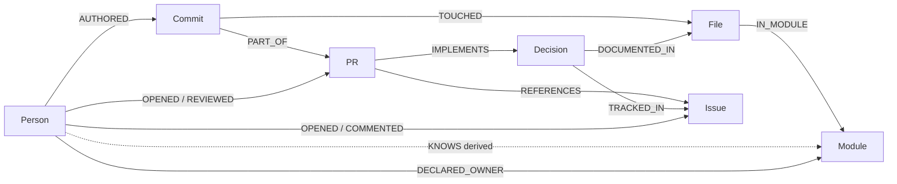

# Graph Hacks Plan: Bus Factor Company Brain

Oct 14, 2026 · @Manjunatha Shettigere Krishna

## The hackathon

[Graph Hacks](https://www.wemakedevs.org/hackathons/falkordb) is an online WeMakeDevs × FalkorDB hackathon with $20,000 in prizes. Hacking runs from 15 Oct 2026, 12:01 AM IST, to 18 Oct 2026, 11:59 PM IST. Thursday and Friday are workdays, so the real budget is two evenings plus the weekend.

| Track | Focus | Prize |
| --- | --- | --- |
| 01 Agents That Act on Connected Data | Multi-hop reasoning, graph algorithms as agent tools, explainable results | iPhone 18 Pro |
| 02 Agent Memory and Coordination | Memory that persists across sessions and is shared between agents | PS5 with GTA VI |
| 03 Company Brain | People, teams, projects, docs and decisions in one graph; who owns what; tracing decisions; keeping knowledge current | M6 Mac Mini |

One project can enter one, two or all three tracks; each has its own prize. Side prizes: best blog post (AirPods 5) and a t-shirt for the top 50 teams.

## Three rules that shape the plan

1. **Public data only.** Only public, synthetic or your own data may go into the graph.
2. **No starting from existing code.** Main coding and design must begin after 12:01 AM on 15 Oct. Before that, ideas, notes, graph-model sketches and diagrams are allowed. Knowledge is fair to use.
3. **The graph must be essential.** If the product still works with FalkorDB removed, it counts as decoration. Answers must come from graph traversals, not vector search with a graph view on top.

Disclose any AI coding assistants used.

The submission needs a public repo, a README with setup steps and the graph data model, the Cypher queries or algorithms the product depends on, a demo video, a live deployment or full local setup steps, and the track(s) entered ([rules](https://www.wemakedevs.org/hackathons/falkordb/rules)).

## The project: Bus Factor

Build a company brain over Delta Lake, the delta-io/delta repo on GitHub (decided 14 Oct). The graph holds its people, code modules, PRs, issues, design proposals and releases. The demo answers one question: what knowledge does the project lose when someone leaves?

Why Delta Lake: about 2,236 commits from 218 authors in the last two years (Airflow: 16,109 from 1,416), so ingestion fits one evening. Its `protocol_rfcs/` folder splits RFCs into `accepted/` and `rejected/`, giving real Decision nodes with outcomes. Map files to modules by top-level folder (`spark/`, `kernel/`, `connectors/`). Optional bonus: a small FalkorDB repo as a second "company" if Saturday allows.

What makes it stand out:

- **Departure-impact simulator.** Remove a maintainer from the graph. Using centrality and connected components, the agent reports which modules lose their only expert and which design decisions have no participant left. Shortest path and overlapping work pick the best successor for each area. Most teams will build Q&A chatbots; this is something only a graph can do.
- **Decision tracing.** "Why does module X work this way?" follows File → Commit → PR → Issue → Design doc → Person, and the UI shows that path beside the answer.
- **Freshness.** Edges carry `valid_from` / `valid_to`, and new commits load incrementally. The agent flags stale knowledge, such as a doc describing a file that has changed 14 times since.
- **Memory (also enters Track 02).** Each Q&A session becomes an episode node linked to the entities it touched. User corrections are stored as facts with their source. The next session can say what changed since last time.

Keep scope tight: about two years of one repo, so ingestion fits GitHub API rate limits. A narrow demo that works beats a broad one that is flaky.

## Graph model

Seven node labels in one `delta` graph, almost all loaded without an LLM, plus a small memory graph per user. Every write is a `MERGE` on a stable key, so re-running any load is safe. Timestamps are stored as epoch milliseconds.



Per-user memory graph `mem_<login>`: `Session -ASKED-> Question -ABOUT-> Entity <-CORRECTS- Correction`.

Decision is the node most teams won't have: it turns "why does this work this way?" into a path the agent can follow and show.

| Label | Key | Other properties | Source |
| --- | --- | --- | --- |
| Person | `login` | `name`, `lastSeen` (derived) | git log; GitHub API maps each author email to a login once |
| Commit | `sha` | `ts`, `subject`, `area` (from the `[Spark]` / `[Kernel]` subject prefix) | `git log --numstat` |
| File | `path` | `lastModified` (derived) | `git log --numstat` |
| Module | `name` | none | First path segment: `spark`, `kernel`, `connectors`, `flink`, `python`, … |
| PR | `number` | `title`, `state`, `mergedAt`, `body` | GitHub API |
| Issue | `number` | `title`, `state`, `createdAt` | GitHub API |
| Decision | `slug` | `title`, `status` (proposed / accepted / rejected), `proposedOn`, `decidedOn` | The three tables in `protocol_rfcs/README.md` (19 RFCs) |

| Relationship | From → To | Source |
| --- | --- | --- |
| `AUTHORED` | Person → Commit | git |
| `TOUCHED {added, deleted}` | Commit → File | git numstat |
| `IN_MODULE` | File → Module | Path prefix |
| `PART_OF` | Commit → PR | `(#N)` at the end of the subject (2,233 of 2,236 recent commits) |
| `OPENED`, `REVIEWED` | Person → PR | GitHub API |
| `OPENED`, `COMMENTED` | Person → Issue | GitHub API, RFC issues only to save rate limit |
| `REFERENCES` | PR → Issue | `#N` in the PR body |
| `TRACKED_IN` | Decision → Issue | RFC README table |
| `DOCUMENTED_IN` | Decision → File | RFC markdown path |
| `IMPLEMENTS {via, confidence}` | PR → Decision | RFC issue cited in the PR body (high), or the RFC's feature name in the PR title (low) |
| `SUPERSEDED_BY {source}` | Decision → Decision | Managed Commits → Catalog-Managed, stated in PR #4382 |
| `DECLARED_OWNER` | Person → Module | `.github/CODEOWNERS` |
| `KNOWS {commits, lastTouched}` | Person → Module | Derived after each load |
| `WORKS_WITH {sharedFiles}` | Person → Person | Derived after each load |
| `PARTICIPATED_IN` | Person → Decision | Derived after each load |

Two things found in the repo shape `IMPLEMENTS`. Commit messages almost never cite RFC issue numbers (#4381 once, #5555 twice, the rest zero), so PR bodies from the API are the reliable link. Keyword matching needs word boundaries: a loose `ICT` match also hits "conflict" and "dict". Keep the `via` and `confidence` properties so the agent can say how sure a link is.

**Memory graph, one per user (`mem_<login>`):** `Session -ASKED-> Question -ABOUT-> Entity <-CORRECTS- Correction`. `Entity.key` (for example `module:kernel` or `decision:catalog-managed`) names a node in the `delta` graph. Cypher cannot query across graphs, so the agent joins the two by key in code.

## Core Cypher queries

Thirteen queries in four groups: load, derive, agent tools, memory. Parameters start with `$`; `$since` is "now minus 365 days" in epoch ms, passed from the app. Algorithm calls use the syntax on the [FalkorDB algorithm pages](https://docs.falkordb.com/algorithms).

### Setup

```cypher
CREATE INDEX FOR (p:Person) ON (p.login)
CREATE INDEX FOR (c:Commit) ON (c.sha)
CREATE INDEX FOR (f:File) ON (f.path)
CREATE INDEX FOR (m:Module) ON (m.name)
CREATE INDEX FOR (pr:PR) ON (pr.number)
CREATE INDEX FOR (i:Issue) ON (i.number)
CREATE INDEX FOR (d:Decision) ON (d.slug)
```

### Load (idempotent, batches of about 500)

**1. Commits and files**, from `git log --numstat`:

```cypher
UNWIND $commits AS c
MERGE (p:Person {login: c.author})
MERGE (k:Commit {sha: c.sha})
  ON CREATE SET k.ts = c.ts, k.subject = c.subject, k.area = c.area
MERGE (p)-[:AUTHORED]->(k)
WITH k, c
OPTIONAL MATCH (pr:PR {number: c.pr})
FOREACH (_ IN CASE WHEN pr IS NULL THEN [] ELSE [1] END | MERGE (k)-[:PART_OF]->(pr))
WITH k, c
UNWIND c.files AS f
MERGE (fl:File {path: f.path})
MERGE (m:Module {name: f.module})
MERGE (fl)-[:IN_MODULE]->(m)
MERGE (k)-[t:TOUCHED]->(fl)
  ON CREATE SET t.added = f.added, t.deleted = f.deleted
```

Load PRs before commits so `PART_OF` finds them, or run a second pass that links `Commit.pr` once PRs are in.

**2. Decisions**, parsed from the RFC README tables:

```cypher
UNWIND $rfcs AS r
MERGE (d:Decision {slug: r.slug})
SET d.title = r.title, d.status = r.status,
    d.proposedOn = r.proposedOn, d.decidedOn = r.decidedOn
MERGE (i:Issue {number: r.issue})
MERGE (d)-[:TRACKED_IN]->(i)
MERGE (f:File {path: r.path})
MERGE (d)-[:DOCUMENTED_IN]->(f)
```

```cypher
MATCH (old:Decision {slug: 'managed-commits'}), (new:Decision {slug: 'catalog-managed'})
MERGE (old)-[s:SUPERSEDED_BY]->(new)
SET s.source = 'PR #4382'
```

### Derive (rerun after every load)

**3. Expertise and activity.** Count distinct commits, never paths: FalkorDB only checks that an unreferenced relationship exists, so path counts can be wrong.

```cypher
MATCH (p:Person)-[:AUTHORED]->(c:Commit)-[:TOUCHED]->(:File)-[:IN_MODULE]->(m:Module)
WITH p, m, count(DISTINCT c) AS commits, max(c.ts) AS lastTouched
MERGE (p)-[k:KNOWS]->(m)
SET k.commits = commits, k.lastTouched = lastTouched
```

```cypher
MATCH (p:Person)-[:AUTHORED]->(c:Commit)
WITH p, max(c.ts) AS last
SET p.lastSeen = last
WITH p WHERE p.lastSeen > $since
SET p:Active
```

**4. Collaboration and decision participation:**

```cypher
MATCH (a:Person)-[:AUTHORED]->(c1:Commit)-[:TOUCHED]->(f:File)<-[:TOUCHED]-(c2:Commit)<-[:AUTHORED]-(b:Person)
WHERE id(a) < id(b) AND c1.ts > $since AND c2.ts > $since
WITH a, b, count(DISTINCT f) AS shared
WHERE shared >= $minShared
MERGE (a)-[w:WORKS_WITH]->(b)
SET w.sharedFiles = shared
```

```cypher
MATCH (p:Person)-[:OPENED|REVIEWED]->(:PR)-[:IMPLEMENTS]->(d:Decision)
MERGE (p)-[:PARTICIPATED_IN]->(d)
```

```cypher
MATCH (p:Person)-[:OPENED|COMMENTED]->(:Issue)<-[:TRACKED_IN]-(d:Decision)
MERGE (p)-[:PARTICIPATED_IN]->(d)
```

### Agent tools

**5. Bus factor per module:** the fewest people who together wrote half of the module's recent commits.

```cypher
MATCH (p:Person)-[k:KNOWS]->(m:Module)
WHERE k.lastTouched > $since
WITH m, p.login AS login, k.commits AS c
ORDER BY c DESC
WITH m, collect({login: login, c: c}) AS ranked, sum(c) AS total
RETURN m.name AS module,
       reduce(acc = {n: 0, s: 0}, x IN ranked |
         CASE WHEN acc.s * 2 >= total THEN acc ELSE {n: acc.n + 1, s: acc.s + x.c} END).n AS busFactor,
       ranked[0].login AS topExpert,
       toFloat(ranked[0].c) / total AS topShare
ORDER BY busFactor, topShare DESC
```

**6. Departure impact,** the headline of the demo:

```cypher
MATCH (gone:Person {login: $login})-[gk:KNOWS]->(m:Module)
WHERE gk.lastTouched > $since
OPTIONAL MATCH (other:Person)-[ok:KNOWS]->(m)
WHERE other <> gone AND ok.lastTouched > $since AND ok.commits >= $minCommits
WITH m, gk, collect(other.login) AS remaining
RETURN m.name AS module, gk.commits AS theirCommits, size(remaining) AS expertsLeft, remaining,
       CASE size(remaining) WHEN 0 THEN 'ORPHANED' WHEN 1 THEN 'AT RISK' ELSE 'COVERED' END AS risk
ORDER BY expertsLeft, theirCommits DESC
```

**7. Decisions left without participants:**

```cypher
MATCH (gone:Person {login: $login})-[:PARTICIPATED_IN]->(d:Decision)
OPTIONAL MATCH (other:Person)-[:PARTICIPATED_IN]->(d)
WHERE other <> gone AND other.lastSeen > $since
RETURN d.title AS decision, d.status AS status,
       count(other) AS othersStillActive, collect(other.login) AS whoToAsk
ORDER BY othersStillActive
```

**8. Successor for one module:** who has recently worked on the same files.

```cypher
MATCH (gone:Person {login: $login})-[:AUTHORED]->(:Commit)-[:TOUCHED]->(f:File)-[:IN_MODULE]->(:Module {name: $module})
WITH gone, collect(DISTINCT f) AS theirFiles
MATCH (cand:Person)-[:AUTHORED]->(c:Commit)-[:TOUCHED]->(f:File)
WHERE cand <> gone AND f IN theirFiles AND c.ts > $since
RETURN cand.login AS successor, count(DISTINCT f) AS sharedFiles, size(theirFiles) AS outOf
ORDER BY sharedFiles DESC
LIMIT 5
```

**9. Bridges and splits.** Betweenness finds the people who connect otherwise separate groups:

```cypher
CALL algo.betweenness({nodeLabels: ['Active'], relationshipTypes: ['WORKS_WITH']})
YIELD node, score
RETURN node.login AS person, score
ORDER BY score DESC
LIMIT 10
```

Then check whether the collaboration graph splits without them. Run this, remove the label with `MATCH (p:Person {login: $login}) REMOVE p:Active`, run it again, and restore the label.

```cypher
CALL algo.WCC({nodeLabels: ['Active'], relationshipTypes: ['WORKS_WITH']})
YIELD node, componentId
RETURN count(DISTINCT componentId) AS groups
```

**10. Decision trace.** Return the path itself so the UI can draw it beside the answer:

```cypher
MATCH p = (f:File {path: $path})<-[:TOUCHED]-(c:Commit)-[:PART_OF]->(:PR)
          -[:IMPLEMENTS]->(:Decision)-[:TRACKED_IN]->(:Issue)
RETURN p, c.ts AS ts
ORDER BY ts DESC
LIMIT 5
```

The "why not?" version, for rejected or replaced decisions:

```cypher
MATCH (old:Decision {slug: $slug})-[s:SUPERSEDED_BY]->(new:Decision)-[:TRACKED_IN]->(i:Issue)
OPTIONAL MATCH (p:Person)-[:PARTICIPATED_IN]->(new)
RETURN old.title AS rejected, s.source AS evidence, new.title AS chosenInstead,
       i.number AS discussion, collect(p.login) AS whoToAsk
```

**11. Drift since a decision:** how much the code behind an accepted decision has changed, and how many of those editors took no part in it.

```cypher
MATCH (d:Decision {status: 'accepted'})
OPTIONAL MATCH (insider:Person)-[:PARTICIPATED_IN]->(d)
WITH d, collect(insider) AS insiders
MATCH (d)<-[:IMPLEMENTS]-(:PR)<-[:PART_OF]-(:Commit)-[:TOUCHED]->(f:File)
WITH d, insiders, collect(DISTINCT f) AS files
UNWIND files AS f
MATCH (f)<-[:TOUCHED]-(later:Commit)<-[:AUTHORED]-(p:Person)
WHERE later.ts > d.decidedOn
RETURN d.title AS decision,
       count(DISTINCT later) AS changesSinceDecision,
       count(DISTINCT CASE WHEN p IN insiders THEN null ELSE p END) AS editorsOutsideDecision
ORDER BY changesSinceDecision DESC
```

**12. Declared versus actual owners:**

```cypher
MATCH (m:Module)
OPTIONAL MATCH (o:Person)-[:DECLARED_OWNER]->(m)
WITH m, collect(o.login) AS declared
MATCH (p:Person)-[k:KNOWS]->(m)
WHERE k.lastTouched > $since
WITH m, declared, p, k
ORDER BY k.commits DESC
WITH m, declared, collect(p.login)[0..3] AS actualTop3
RETURN m.name AS module, declared, actualTop3,
       [x IN declared WHERE NOT x IN actualTop3] AS ownersNotInTop3
```

### Memory (in each user's `mem_<login>` graph)

**13. Write an episode, store a correction, recall before answering:**

```cypher
MERGE (s:Session {id: $sessionId})
  ON CREATE SET s.startedAt = timestamp()
CREATE (q:Question {text: $text, ts: timestamp(), cypher: $cypher})
MERGE (s)-[:ASKED]->(q)
WITH q
UNWIND $entityKeys AS key
MERGE (e:Entity {key: key})
MERGE (q)-[:ABOUT]->(e)
```

```cypher
MERGE (e:Entity {key: $key})
CREATE (c:Correction {text: $text, ts: timestamp(), source: $source})
MERGE (c)-[:CORRECTS]->(e)
```

```cypher
MATCH (e:Entity) WHERE e.key IN $keys
OPTIONAL MATCH (e)<-[:ABOUT]-(q:Question)
OPTIONAL MATCH (e)<-[:CORRECTS]-(c:Correction)
RETURN e.key AS entity, max(q.ts) AS lastAsked,
       collect(DISTINCT q.text)[0..3] AS earlierQuestions,
       collect(DISTINCT c.text) AS corrections
```

The agent then asks the `delta` graph what changed since `lastAsked`, for example new commits in that module, and opens with it.

### Test these first on Thursday

- [ ] `SET p:Active` / `REMOVE p:Active` label changes, used by query 9
- [ ] `reduce` with a map accumulator, and `ORDER BY` before `collect` keeping order (query 5)
- [ ] `FOREACH` with the `CASE` trick for the optional `PART_OF` link (query 1)
- [ ] Whether `GRAPH.COPY` exists in your FalkorDB version. If it does, run the query 9 what-if on a copy instead of changing labels in the shared graph
- [ ] Runtime of the `WORKS_WITH` derive on about 2,200 commits; raise `$minShared` or skip very busy files if it is slow

## Schedule

| When | Goal |
| --- | --- |
| Wed 14 Oct, before 12:01 AM | Pick the repo; sketch the graph model and core Cypher queries (design only) |
| Thu 15 Oct, evening | FalkorDB in Docker; load GitHub people, commits, PRs, issues (plain ingestion, no LLM) |
| Fri 16 Oct, evening | LLM extraction of decisions from PRs and design docs; agent with Cypher and graph-algorithm tools |
| Sat 17 Oct | Departure simulator, memory layer, UI that shows the traversal path beside each answer |
| Sun 18 Oct | Deploy, README with data model and queries, demo video, blog post. Submit by evening; close is 11:59 PM IST |

Thursday and Friday are evenings only; Saturday and Sunday carry the heavier work. Leave Sunday evening for the video and submission rather than features.
