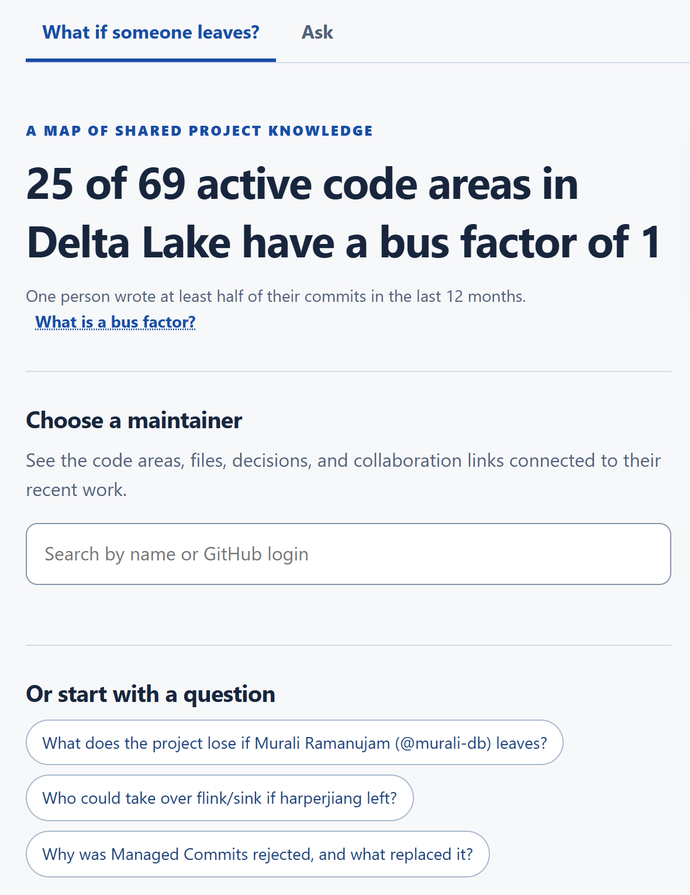
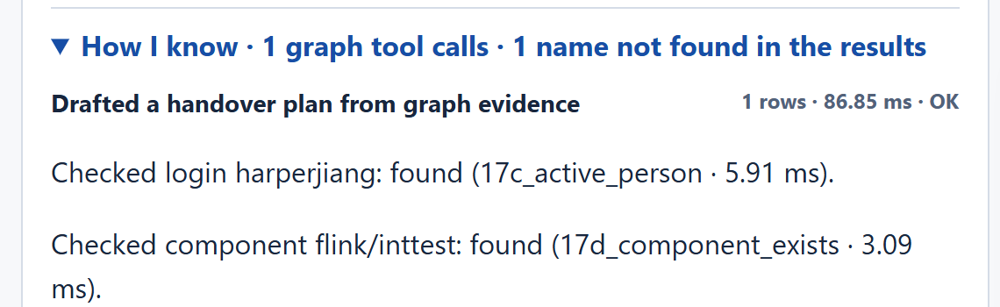

# If a maintainer left tomorrow, who would know their code? I asked a graph

*Bus Factor turns two years of public Delta Lake history into a FalkorDB graph of people, code, reviews and design decisions. Here is what it found, the measurement I got wrong, and why code reviews mattered more than I expected.*


*Each square is a Delta Lake code area with enough recent activity to measure; each line joins it to its most active author in the last 12 months. Data: public delta-io/delta history, queried on 18 October 2026.*

## The repository remembers everything except who to ask

Picture a Friday message in an open-source project's chat: one of the most active maintainers is moving on. Technically, nothing is lost. Every commit, pull request and design proposal is still there.

And yet on Monday nobody can quite answer the questions that matter. Which parts of the code did only that person work on recently? Who else has at least seen those changes? Which design decisions did they help shape, and is anyone left who took part? If someone has to take over, where should they start reading, and what should they ask before the person who knows is gone?

Engineers have a blunt name for this risk: the *bus factor*, the number of people who would have to disappear before part of a project has nobody left who knows it. I measure it per code area: the fewest people whose commits in the last 12 months add up to at least half of that area's commits. A bus factor of 1 means one person wrote at least half of what changed there recently.

I built Bus Factor for the [WeMakeDevs × FalkorDB Graph Hacks](https://www.wemakedevs.org/hackathons/falkordb) hackathon to answer one question about a real project, [Delta Lake](https://github.com/delta-io/delta): *what does the project lose if this maintainer leaves?*

## The answer is spread across four places

Each public source holds one piece. Git history says who changed which files. GitHub says which commits belong to which pull request, and who reviewed it. The `protocol_rfcs` folder lists 19 design decisions (RFCs), each with a tracking issue. `CODEOWNERS` says who is officially responsible for what.

None of them on its own answers "who else knows this code?". Take `flink/inttest`, the integration tests of Delta Lake's Flink connector. In the last 12 months, Hao Jiang (@harperjiang) is the only person with two or more commits there. Count commits and Hao Jiang looks like the only person who knows it. Follow one of those commits into its pull request, and the picture changes.


*Seven real nodes from the graph. Following code area → file → commit → pull request → reviewer finds scottsand-db, who reviewed the change but has no recent commits in the area.*

That is all a knowledge graph is: things (nodes) joined by named, directed relationships, so that a question becomes a path to follow. [FalkorDB](https://docs.falkordb.com/) stores the graph and answers queries written in [Cypher](https://docs.falkordb.com/cypher/), a language whose patterns look like the arrows in the diagram. Here is the pattern Bus Factor uses to find who reviewed a code area (from [`06_departure_impact.cypher`](https://github.com/Manjunathask/company-brain-falkon-db/blob/main/queries/06_departure_impact.cypher), wrapped to fit):

```cypher
OPTIONAL MATCH (reviewer:Person:Active)-[review:REVIEWED]->(pr:PR)
               <-[:PART_OF]-(rc:Commit)-[:TOUCHED]->(rf:File)
               -[:IN_COMPONENT]->(component)
```

Read it left to right: an active person reviewed a pull request; a commit is part of it; the commit touched a file; the file belongs to this code area. SQL could do the same lookup with a handful of joins. What the graph gave me is that every answer can carry the path that produced it, and that the same relationships also feed graph algorithms, separate memory graphs and a copy-and-simulate step, all of which appear below.

## What I built

Bus Factor loads two years of public `delta-io/delta` activity: 2,240 commits, 3,602 pull requests with their reviews, the 19 RFC decisions and their tracking issues, `CODEOWNERS`, and the 4,427 files present at the latest commit. Files are grouped into code areas, packages inside modules such as `flink/inttest`. The result is a graph of 11,033 nodes and 39,869 relationships, rebuilt in about 11 seconds from a 1.7 MB snapshot in the repository, so nobody needs a GitHub token to run it.

The app opens on the measurement and a choice:


*The landing view. Pick a maintainer from a list ranked by recent commits, or start from a suggested question.*

Underneath, data flows down into FalkorDB, and answers come back up through a fixed set of queries.

![An architecture diagram with five layers. Public sources (git history, GitHub GraphQL API, RFC table, CODEOWNERS) feed Python parsers and a public snapshot. Load, link and derive steps run Cypher files into FalkorDB, which holds separate graphs: delta for repository facts, mem_team for shared notes, one mem_v graph per visitor, and temporary whatif copies. A Python tool layer runs a fixed catalogue of read-only queries, checks names first and joins memory in Python. A web app calls the tools directly; an agent running Claude Sonnet 5.5 picks tools but never writes Cypher.](assets/03-architecture.png)
*How the pieces fit. Repository facts, shared notes and each visitor's history live in separate FalkorDB graphs. Python joins them by a stable key, because Cypher cannot traverse between graphs.*

Two decisions shaped everything else. First, no Cypher is generated at runtime. Each capability is a tool backed by one `.cypher` file whose header says what it answers and why it is shaped that way. The departure view and handover packets call those tools directly, with no language model involved, and read-only tools run through `GRAPH.RO_QUERY`.

Second, the chat agent (Claude Sonnet 5.5) only picks a tool and fills in its parameters. Every login or code area it names is checked against the graph first, so a typo such as `harper-jiang` comes back as "not in the graph" rather than an empty result that reads like "nothing at risk". Afterwards, the names in its reply are compared with the rows the tools returned.

## My first headline was wrong

When I first put a number on the landing page, it said that **42 of 87** active code areas had a bus factor of 1 "in the last 12 months". It was a good headline. It was also measuring something else.

The day before submission, I asked a second model (Codex on GPT-6-Astra) to review the project the way a sceptical judge would, and had Claude Code check each finding against the code and the live graph. The findings held up, and the two most important were about how risk was counted.

The first was a mix-up of time windows. The loader derives a `KNOWS` relationship between each person and each area, holding their commit count over the full two loaded years and the date of their latest commit. The bus-factor query kept people whose *latest* commit fell inside the 12-month window, then added up their *two-year* counts. Someone with eight old commits and one recent one counted as nine recent commits.


*Same label, two calculations. Re-running both queries on the same graph on 18 October still gives 42 of 87 and 25 of 69: the project didn't change, the measurement did.*

The second was a missing threshold. People who would remain needed two commits in an area to count, but the person leaving needed only one. When I simulated Murali Ramanujam (@murali-db) leaving, five areas came back "orphaned", and four of them rested on a single commit.

The fix counts exactly what the label says, straight from the commits (from [`05b_bus_factor_component.cypher`](https://github.com/Manjunathask/company-brain-falkon-db/blob/main/queries/05b_bus_factor_component.cypher), wrapped to fit):

```cypher
MATCH (p:Person)-[:AUTHORED]->(commit:Commit)-[:TOUCHED]->(f:File)
      -[:IN_COMPONENT]->(component:Component)
WHERE commit.ts > $since AND coalesce(p.bot, false) = false
  AND coalesce(commit.bulk, false) = false
  AND coalesce(f.exists, true) = true
WITH component, p, count(DISTINCT commit) AS c
WHERE c >= $minCommits
```

`count(DISTINCT commit)` matters as much as the date filter: a commit that touches 30 files in an area is one contribution, not 30. Bulk commits that touch more than 100 files, and files deleted since, are left out of expertise. The person leaving now needs the same two commits as everyone else. The corrected headline is **25 of 69**.

The project didn't get safer in an afternoon; the measurement moved closer to its label. It was the most useful thing that happened during the build, because it changed the product's vocabulary too. The review asked a better question: if authorship is one signal, who reviewed that code? Across the 15 most active people, the 19 areas where one of them was the only recent author each had between 2 and 11 active reviewers. "Orphaned" was the wrong word. The label became `NO OTHER AUTHOR`, and reviewers are listed beside it, never folded into it, because writing code and reviewing it are different kinds of evidence.

## One maintainer, one area, one handover

To show the whole flow I'll use Hao Jiang, because the data makes a clear example, not because anything suggests they are leaving. Choosing them in the app asks the graph what a departure would expose, and the app answers in one sentence:

> If Hao Jiang left: 3 code areas where they made 2+ commits in the last 12 months would have no other recent author (3 of them were reviewed by other active people), 5 would have one other recent author, 81 current files would have no other recent editor, and 0 people would lose their link to the main collaboration network.


*The three Flink areas with no other recent author each have five or six active reviewers. The evidence graph draws the relationships the cards count; dotted lines are reviews.*

The last number comes from graph algorithms rather than a pattern match. A derived `WORKS_WITH` relationship links people who recently edited the same files. Bus Factor copies the graph with `GRAPH.COPY`, ranks the person with `algo.betweenness`, removes their `Active` label in the copy, recomputes collaboration groups with `algo.WCC`, checks who dropped out of the largest group, and deletes the copy. For Hao Jiang nobody is cut off. For Murali Ramanujam, who ranks first by betweenness, three people would lose their link to the main collaboration group.

On the `flink/inttest` card, **Draft handover** builds a packet from four queries in about a tenth of a second. Candidates are everyone who recently wrote code in the area or reviewed a pull request that touched it. Each kind of evidence keeps its own column, and the order is a plain sort, not a weighted score: first, how many of the leaving person's pull requests here they reviewed, because that reviewer has already seen these exact changes; then shared files, their own commits, and reviews in the area.

![A diagram linking harperjiang and the code area flink/inttest to three pull requests: 6188 (7 files here), 6192 (3 files) and 6933 (1 file). Teal dotted lines connect the pull requests to their reviewers: huan233usc, tdas and scottsand-db reviewed 6188; scottsand-db reviewed 6192; kaiqijinwow and timothyw553 reviewed 6933. A dashed title-match line joins 6188 to the decision Catalog-Managed Tables. The suggested successor is scottsand-db: reviewed 2 of Hao Jiang's 3 pull requests here, no commits of their own here yet, took part in Catalog-Managed Tables.](assets/05-handover-evidence-chain.png)
*The relationships behind the suggestion. The link from pull request #6188 to Catalog-Managed Tables is dashed because it comes from a keyword in the title, not an explicit reference.*


*The top of the packet: the suggested successor, the evidence table, the files the successor hasn't touched yet, and the pull requests to read first.*

Every clause of the suggestion comes from a column, and the sentence is assembled from the row in Python, not written by a model. Keeping "no commits of their own here yet" next to the recommendation is deliberate: a reviewer is not an author, and the packet says so.


*Further down the packet: the decision to preserve, with its reason quoted from tracking issue #4381, and questions to ask before Hao Jiang leaves.*

Decisions needed the same honesty. Of 283 links between pull requests and RFC decisions, only 53 are explicit: the pull request body cites the RFC's tracking issue, or the pull request edits the RFC document. The other 230 come from a keyword in the title, matched on whole words so that "ICT" doesn't match "conflict". So the packet says "1 title matches (keyword guesses)" and asks Hao Jiang whether [PR #6188](https://github.com/delta-io/delta/pull/6188) really belonged to Catalog-Managed Tables. Why the older Managed Commits design (tracked in issue #2598 as Coordinated Commits) was rejected is quoted word for word from [issue #4381](https://github.com/delta-io/delta/issues/4381) at load time, and [PR #4382](https://github.com/delta-io/delta/pull/4382) is recorded as the evidence that one replaced the other.

None of this is a staffing decision. It is a starting point for a conversation: here is who has seen the changes, here is what they haven't seen, and here is what to ask while the person who knows is still around.

## When a note changes the answer

A repository cannot know whether the suggested person is free. A team learns that in conversation, and a useful tool should remember it without pretending it is a fact like a commit.

So Bus Factor keeps notes in separate graphs: `mem_team` for notes everyone shares, and one `mem_v_<visitor>` graph per browser for that visitor's questions and corrections. For this article I saved the packet, then typed a note saying scottsand-db is "on leave until January". I made that note up for the demo; it says nothing about anyone's real plans.

![A three-column diagram. Repository facts in the delta graph list five candidates and are never edited by notes. A dashed amber team note in the mem_team graph says scottsand-db is unavailable, on leave until January, and is marked made up for the demo. A box explains that the note's key person:scottsand-db is matched to the Person node in Python and passed to the query as an exclusion. The derived suggestion changes from scottsand-db before the note to kaiqijinwow after it, with scottsand-db listed as skipped.](assets/06-memory-changes-recommendation.png)
*Repository facts, an unverified note and the derived suggestion stay separate. They meet only when a packet is built.*

Cypher cannot traverse from one graph to another, so the join happens in Python. The note is stored against the key `person:scottsand-db`; the handover code collects everyone marked unavailable and passes their logins into the same query as `$exclude` (from [`18_handover_candidates.cypher`](https://github.com/Manjunathask/company-brain-falkon-db/blob/main/queries/18_handover_candidates.cypher), shortened):

```cypher
WITH cand.login AS login, cand.login IN $exclude AS skipped,
     reviewedTheirPRs, sharedFiles, areaCommits, areaReviews
ORDER BY skipped, reviewedTheirPRs DESC, sharedFiles DESC,
         areaCommits DESC, areaReviews DESC, login
```

The repository graph is untouched, but the next packet is different:


*After the note, kaiqijinwow is suggested. The packet says what changed since the saved version, and lists scottsand-db as skipped because of an "unverified availability note".*

Because the note lives in shared memory, the chat agent sees it too. Asked to "Draft a handover plan for flink/inttest if harperjiang leaves", it called the same `handover_plan` tool and explained the change:


*The agent's answer. It calls the note unverified, says the evidence for the new suggestion is thin, which is true, and keeps author risk and reviews apart.*


*"How I know" sits under every answer: the tool that ran, the name checks before it, and timings. In this run, the reply check flagged one name in the answer that did not appear in the returned rows.*

## What building it taught me

**A query can be wrong and still look convincing.** 42 of 87 was plausible and came from real data. What caught it was reading the query against its label, and keeping every query in its own commented file is what made that take minutes.

**Separate signals deserve separate columns.** It is tempting to blend commits, reviews and shared files into one expertise score. Every time I kept them apart, and labelled how sure each link was, the output got easier to check and to argue with. The same goes for memory: a note can change a suggestion, never a fact.

**Graph databases have their own performance traps.** While planning a deployment on a small free instance, I measured the snapshot load and found it peaked at 681 MB, for a graph that occupies 12 MB. The commit loader merges and deletes, so FalkorDB holds every row of a batch in memory before writing, and each file row carried a copy of its commit's entire file list. Dropping that variable after the unwind brought the peak down to 51 MB, with an identical graph.

### How it was built, and by whom

This is a solo entry built with AI coding assistants, and the split matters. Before the hackathon, I planned the project with Claude: the departure question, Delta Lake as the data source, and the graph model. I set up the way of working: OpenAI Codex implemented each work package from a written brief, and Claude Code (Claude Opus 5.5) reviewed every result against the live graph. I picked Claude Sonnet 5.5 over Opus for the running agent because the graph tools do the reasoning; a five-question evaluation found it faster and about a third of the cost. I tested the app as a newcomer and wrote the feedback that drove a full redesign: a searchable maintainer list instead of a login box, suggested questions, follow-up questions after each answer. Then I re-tested it from screenshots. I commissioned the pre-submission review and chose which findings to act on. When Codex reached its usage limit, Claude Code built the evidence and handover features directly.

What worked: written briefs, a reviewer that ran everything against the real database, and the rule that every query is a readable file. What didn't: three times, unit tests passed while the live system broke. FalkorDB worded an error differently from what the code expected, `localhost` added a two-second delay on Windows, and the Claude API rejected tool schemas with more than 24 optional parameters. The time-window bug also slipped past every earlier review. It was caught only when a review asked, number by number, whether each one measured what its label claimed.

## What it can and can't tell you

Back to that Friday message. In about a second, Bus Factor can show a team which code areas lose their only recent author, who has reviewed that code anyway, which decisions and pull requests a successor should read, and what to ask before the person goes. It cannot tell anyone who *understands* the code, what was decided on a call or in a private thread, whether the suggested person is free, or whether the code is any good. It measures fingerprints: who wrote and who reviewed public changes over the last year.

That turned out to be enough to start the right conversation. A repository keeps every commit forever. What it doesn't keep is who to ask, and that is the part a graph can hold.

---

*Bus Factor is open source at [github.com/Manjunathask/company-brain-falkon-db](https://github.com/Manjunathask/company-brain-falkon-db). `docker compose up --build` loads the public snapshot and starts the app; every query lives in [`queries/`](https://github.com/Manjunathask/company-brain-falkon-db/tree/main/queries) with a header explaining it. Built for WeMakeDevs × FalkorDB Graph Hacks, October 2026. Figures and screenshots were produced from the live graph on 18 October 2026; counts tied to the 12-month window shift slightly from day to day.*
